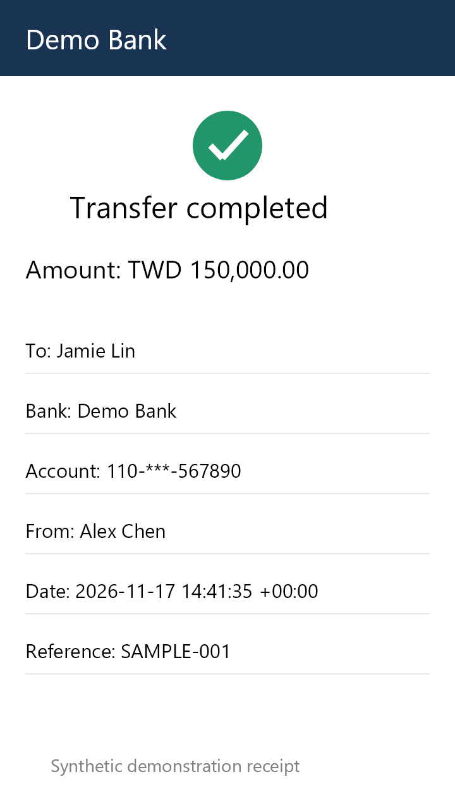
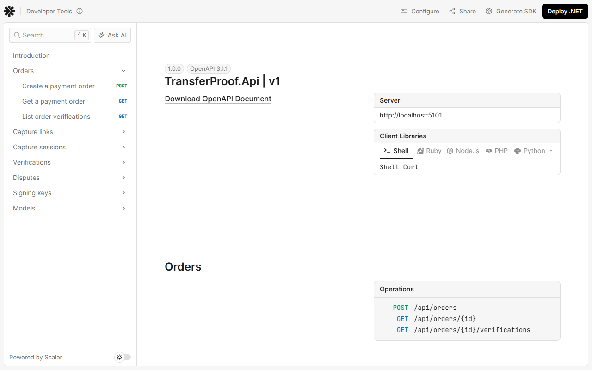
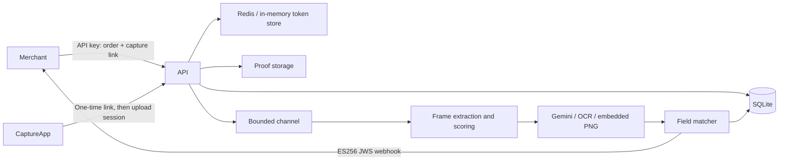

English | [繁體中文](README.zh-TW.md)

# Transfer Proof Verifier

[](https://github.com/Marc-YULIN/transfer-proof-verifier/actions/workflows/ci.yml)  

A service that extracts fields from uploaded transfer receipts, compares them with an order, and signs the result for a merchant webhook.

## Background

Distilled from patterns I built and operated in production payment / membership platforms. This repository is a clean-room implementation with synthetic data.

## Features

- One-time capture links, AES-GCM authenticated tokens, expiring upload sessions, and API key protection for merchants.
- PNG/JPEG/MP4/WebM uploads with size, media signature, expiry, and conditional state checks.
- ffmpeg tail-frame extraction, loading-screen rejection, OCR, configurable extraction providers, and deterministic PNG sample metadata.
- Field-by-field Matched / Mismatched / Unreadable results, extraction audit trails, and automatic disputes.
- ES256 compact JWS webhook delivery with a public JWKS endpoint and per-attempt delivery audit.
- SQLite persistence, optional Redis atomic token consumption, OpenAPI, Scalar, health checks, and isolated integration tests.

## Screenshots



*Synthetic transfer receipt produced by the sample generator (verified as Matched)*



*API reference (Scalar)*

## Architecture



See [architecture](docs/architecture.md) for sequences, state transitions, and the data model.

## Tech Stack

.NET 10, ASP.NET Core Minimal APIs, EF Core SQLite, StackExchange.Redis, SkiaSharp, ffmpeg, optional tesseract CLI, xUnit, NSubstitute, and WebApplicationFactory.

## Getting Started

Requirements: .NET SDK from `global.json`; ffmpeg for videos; tesseract is optional. The walkthrough uses Bash, curl, and jq. Run from the repository root. No external API keys are needed for PNG demonstrations.

```sh
dotnet restore TransferProof.slnx
dotnet build TransferProof.slnx --no-restore
# Regenerate fresh synthetic receipts before creating the order.
dotnet run --project tools/TransferProof.SampleGenerator --no-restore -- --out samples --name transfer-matched --amount 150000 --video
dotnet run --project tools/TransferProof.SampleGenerator --no-restore -- --out samples --name transfer-wrong-amount --amount 149999
# In one terminal; explicit Embedded makes the PNG walkthrough deterministic.
Extraction__Provider=Embedded dotnet run --project src/TransferProof.Api --no-restore
```

PowerShell launch equivalent:

```powershell
$env:Extraction__Provider = 'Embedded'
dotnet run --project src/TransferProof.Api --no-restore
```

The API listens on `http://localhost:5101`; Scalar is at `/scalar`, OpenAPI at `/openapi/v1.json`, and liveness at `/health`. For containers:

```sh
docker compose up --build
```

Compose starts the API with Redis and persistent appdata/storage volumes, Development credentials, and Embedded extraction. Use `Extraction__Provider=Auto` to enable installed OCR for video. Development token keys are ephemeral; set a stable base64 32-byte `Security__TokenKey` to keep links valid across restarts. Outside Development, this key and `Security__MerchantApiKey` are mandatory. The compose configuration is a local demonstration configuration.

## Configuration

Use JSON settings or environment variables with `__` in place of `:`. Thresholds are between 0 and 1. Missing production security settings fail startup.

| Key | Default | Description |
| --- | --- | --- |
| `ConnectionStrings:Database` | `Data Source=appdata/transfer-proof-verifier.db` | SQLite file |
| `ConnectionStrings:Redis` | empty | Empty selects process-local memory; otherwise Redis (compare-and-delete Lua script) |
| `Security:TokenKey` | empty | Base64 32-byte AES key; ephemeral only in Development |
| `Security:MerchantApiKey` | empty; Development `dev-merchant-key` | Merchant API key |
| `Tokens:InstallTokenTtl` | `00:15:00` | Link lifetime |
| `Tokens:SessionTtl` | `00:30:00` | Upload session lifetime |
| `Storage:Root` | `storage` | Proof and evidence root |
| `Storage:MaxUploadBytes` | `52428800` | Per-file maximum; request body reserves 64 KiB for multipart headers |
| `Ffmpeg:Path` | `ffmpeg` | Executable path |
| `Ffmpeg:ScanTailSeconds` | `60` | Scan final N seconds |
| `Ffmpeg:FramesPerSecond` | `2` | Extraction rate |
| `Ffmpeg:TimeoutSeconds` | `60` | Process deadline |
| `Ffmpeg:LoadingVarianceThreshold` | `120` | Minimum non-loading brightness variance |
| `Tesseract:Path` | `tesseract` | Optional OCR executable, detected at startup |
| `Gemini:Endpoint` | `https://generativelanguage.googleapis.com` | Extraction endpoint |
| `Gemini:Model` | `gemini-2.5-flash` | Extraction model |
| `Gemini:ApiKey` | empty | Falls back to `GEMINI_API_KEY` |
| `Gemini:Proxy` | empty | Optional HTTP proxy |
| `Extraction:Provider` | `Auto` | Auto / Gemini / OcrHeuristic / Embedded |
| `Extraction:MaxFrames` | `3` | Maximum selected frames |
| `Matching:ReceiverNameThreshold` | `0.8` | Minimum normalized receiver similarity |
| `Matching:SenderNameThreshold` | `0.7` | Minimum normalized sender similarity |
| `Matching:MinConfidence` | `0.6` | Minimum extraction confidence |
| `Signing:PrivateKeyPemPath` | `appdata/signing-key.pem` | Existing P-256 private key or auto-created local key |
| `Webhook:Url` | empty | Empty disables notification |
| `Webhook:RetryDelaysSeconds` | `[1,4,9]` | Delays after initial attempt; array env keys end in `__0`, `__1`, `__2` |
| `ASPNETCORE_ENVIRONMENT` | Production; launch profile Development | Host environment |
| `ASPNETCORE_URLS` | launch profile `http://localhost:5101` | Listening address |
| `Logging:LogLevel:Default` | Information | Default log level |
| `Logging:LogLevel:Microsoft.AspNetCore` | Warning | Framework log level |
| `Logging:LogLevel:Microsoft.EntityFrameworkCore` | Warning | Database log level |
| `AllowedHosts` | `*` | Host filtering |

## API Walkthrough

```sh
base=http://localhost:5101
key=dev-merchant-key
order="demo-$(date +%s)"
curl -fsS "$base/api/orders" -H "X-Api-Key: $key" -H 'Content-Type: application/json' \
  -d "{\"id\":\"$order\",\"buyerName\":\"Alex Chen\",\"sellerName\":\"Jamie Lin\",\"sellerBank\":\"Demo Bank\",\"sellerAccount\":\"110-234-567890\",\"amount\":150000,\"currency\":\"KRW\"}"
link=$(curl -fsS "$base/api/capture-links" -H "X-Api-Key: $key" -H 'Content-Type: application/json' -d "{\"orderId\":\"$order\"}")
token=$(printf '%s' "$link" | jq -r '.deepLink | split("token=")[1]')
session=$(curl -fsS "$base/api/capture-sessions/exchange" -H 'Content-Type: application/json' -d "{\"token\":\"$token\"}")
sid=$(printf '%s' "$session" | jq -r .sessionId)
stoken=$(printf '%s' "$session" | jq -r .sessionToken)
accepted=$(curl -fsS "$base/api/capture-sessions/$sid/proof" -H "X-Session-Token: $stoken" -F 'file=@samples/transfer-matched.png;type=image/png')
status=$(printf '%s' "$accepted" | jq -r .statusUrl)
for i in $(seq 1 40); do
  result=$(curl -fsS "$base$status" -H "X-Api-Key: $key")
  state=$(printf '%s' "$result" | jq -r .status)
  case "$state" in Completed|Failed) break ;; esac
  sleep 0.25
done
printf '%s\n' "$result" | jq .
# Expected: status Completed, verdict Matched.

# A second exchange of the same token returns 401 with code token_used.
curl -sS "$base/api/capture-sessions/exchange" -H 'Content-Type: application/json' -d "{\"token\":\"$token\"}"

# Get a fresh session for the mismatched proof.
link=$(curl -fsS "$base/api/capture-links" -H "X-Api-Key: $key" -H 'Content-Type: application/json' -d "{\"orderId\":\"$order\"}")
token=$(printf '%s' "$link" | jq -r '.deepLink | split("token=")[1]')
session=$(curl -fsS "$base/api/capture-sessions/exchange" -H 'Content-Type: application/json' -d "{\"token\":\"$token\"}")
sid=$(printf '%s' "$session" | jq -r .sessionId)
stoken=$(printf '%s' "$session" | jq -r .sessionToken)
accepted=$(curl -fsS "$base/api/capture-sessions/$sid/proof" -H "X-Session-Token: $stoken" -F 'file=@samples/transfer-wrong-amount.png;type=image/png')
status=$(printf '%s' "$accepted" | jq -r .statusUrl)
for i in $(seq 1 40); do
  result=$(curl -fsS "$base$status" -H "X-Api-Key: $key")
  state=$(printf '%s' "$result" | jq -r .status)
  case "$state" in Completed|Failed) break ;; esac
  sleep 0.25
done
printf '%s\n' "$result" | jq .
# Expected: verdict Mismatched and a disputeId.
dispute=$(printf '%s' "$result" | jq -r .disputeId)
curl -fsS "$base/api/disputes?status=Open" -H "X-Api-Key: $key"
curl -fsS -X POST "$base/api/disputes/$dispute/resolve" -H "X-Api-Key: $key"
curl -fsS "$base/api/orders/$order/verifications" -H "X-Api-Key: $key"
curl -fsS "$base/.well-known/jwks.json"
```

For HTTP editor requests, use `src/TransferProof.Api/TransferProof.Api.http`. To inspect a webhook, set `Webhook__Url` to a receiver you control before starting the API. The receiver gets `{"jws":"<compact JWS>"}` with `X-Signature-Kid`. Verify against the trusted server's JWKS; then enforce `iat` freshness and deduplicate `verificationId`. A signature establishes who issued the result, not whether the uploaded screen is authentic.

```csharp
using System.Net.Http.Json;
using TransferProof.Core.Abstractions;
using TransferProof.Infrastructure;

// receiverBody is the parsed webhook body, and client targets a trusted verifier.
var keys = await client.GetFromJsonAsync<JsonWebKeySet>("/.well-known/jwks.json", cancellationToken);
var valid = JwsVerifier.Verify(receiverBody.GetProperty("jws").GetString()!, keys!);
// After valid == true, decode the payload and check iat / verificationId.
```

## Design Decisions

1. **Atomic compare-and-delete token consumption.** Each order has one link slot; issuing a new link overwrites the stored hash, so only the latest link is valid. Exchange deletes the slot only if it still holds the presented token's hash (a Lua script on Redis, a compare-and-remove `TryRemove` in memory). Concurrent exchanges of the same link have exactly one winner, and replaying an older link returns `token_superseded` without burning the current one.
2. **Two-stage credentials.** The install link only bootstraps an expiring session; uploads use a separate 32-byte random credential stored only as a SHA-256 hash. Session claims and verification insertion share a database transaction, preventing duplicate uploads.
3. **Score before extraction.** Low variance or sparse edges reject likely loading screens before OCR or remote calls. Later frames win scoring ties; the most complete successful extraction wins, with confidence breaking ties. This reduces remote cost but simple screens can be false negatives.
4. **Provider substitution.** Auto chooses Gemini when a key exists, otherwise local tesseract OCR, otherwise embedded sample metadata. Runtime provider errors are audited per frame, not silently rerouted. Embedded is explicitly a synthetic demo mechanism; metadata is forgeable and absent from video frames.
5. **JWS and JWKS.** P-256 signatures allow merchants to verify results without a shared signing secret. The persisted private key produces a stable thumbprint kid. Replacing its file while stopped rotates the key; publishing overlapping old/new keys is future work. The receiver must also reject stale/replayed events.
6. **Exact monetary storage.** Core uses decimal; SQLite stores an integer scaled by 10^4 so SQL ordering, ranges, and sums stay exact. Inputs exceeding four fractional digits or the long range are rejected. Floating-point conversion would lose precision.
7. **Auditability and privacy.** Every selected frame attempt records provider, duration, success, and TraceId, with account-masked response excerpts capped at 2000 characters. The original evidence remains private on disk. No raw provider error body, token, API key, or full account is written to application logs.
8. **Explicit operational limits.** The bounded queue and webhook retries are process-local, with no durable outbox or restart recovery. SQLite supports this single-instance demonstration; a crash between database commit and queue insertion needs operational recovery. Tokens and database writes are separate resources and are not a distributed transaction. A Failed verification requires investigation; a failed webhook does not change a completed verdict.
9. **Matching boundaries.** Exact amount/currency, visible account suffix, normalized sender/receiver names, completion status, confidence, and transfer time are checked. Missing amount or account is Unreadable; missing sender fails; missing transfer time is skipped. Matched indicates field agreement only and does not prove bank settlement. Receipt forgery detection is outside this demonstration.

## Testing

```sh
dotnet build TransferProof.slnx --no-restore
dotnet test TransferProof.slnx --no-restore
```

Tests cover parsing, masking, fuzzy names, field verdicts, atomic consumption under 50 concurrent calls, token tampering/expiry, image scoring, PNG CRC/metadata, JWS tampering and kid validation, stubbed Gemini retries, and API workflows with isolated temporary SQLite files. HTTP tests use stub handlers and never call an external service. ffmpeg-specific tests skip automatically when the executable is absent. `ManualTimeProvider` controls token time.

## Project Structure

```text
src/TransferProof.Core/                 Domain, contracts, matching, PNG sample format
src/TransferProof.Infrastructure/       Persistence, tokens, media, providers, worker, signing
src/TransferProof.Api/                  Endpoints and composition
 tests/TransferProof.Tests/             Unit and integration tests
 tools/TransferProof.SampleGenerator/   Synthetic receipt and video CLI
samples/                               Fictional fixtures and generation commands
docs/architecture.md                   Diagrams and operational boundaries
```

## Roadmap

- Durable work queue and webhook outbox with recovery and deduplication.
- Atomic compare-and-delete link exchange and coordinated token/session persistence.
- Overlapping signing-key rotation and restricted evidence access/retention.
- Broader OCR layouts and evaluated false-positive/false-negative rates.
- Multi-instance persistence, rate limits, and authentic bank settlement confirmation.

## License

[MIT](LICENSE).
