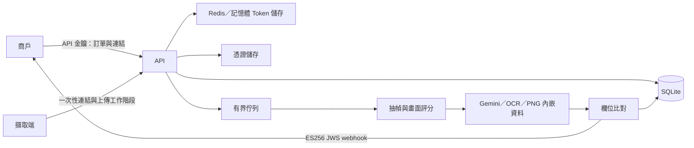

[English](README.md) | 繁體中文

# 轉帳證明驗證服務

從上傳的轉帳憑證擷取欄位、與訂單比對，並將簽章結果透過 webhook 傳給商戶。

## Background

本專案萃取自我在正式環境建置與維運金流／會員平台的實務模式，以獨立重新實作的方式建立，所有範例皆為合成資料。

## Features

- 一次性擷取連結、AES-GCM 驗證加密、限時上傳工作階段與商戶 API 金鑰驗證。
- 支援 PNG/JPEG/MP4/WebM，檢查檔案大小、檔頭、有效期限與狀態條件。
- 使用 ffmpeg 擷取影片尾段、排除載入畫面，支援 OCR、可替換提供者與可重現的 PNG 範例資料。
- 逐欄位產生相符、不符或無法辨識結果，保留擷取稽核，異常時自動開立爭議單。
- ES256 JWS webhook、公開 JWKS 金鑰與每次通知嘗試的稽核紀錄。
- SQLite 持久化、可選用 Redis 原子核銷、OpenAPI、Scalar、健康檢查與隔離的整合測試。

## Architecture



詳見[架構文件](docs/architecture.md)的時序、狀態轉換與資料模型。

## Tech Stack

.NET 10、ASP.NET Core Minimal APIs、EF Core SQLite、StackExchange.Redis、SkiaSharp、ffmpeg、選用的 tesseract CLI、xUnit、NSubstitute 與 WebApplicationFactory。

## Getting Started

需要指定版本的 .NET SDK（見 `global.json`）；影片需 ffmpeg，tesseract 可選。操作範例使用 Bash、curl 與 jq，請在專案根目錄執行。PNG 示範不需要任何外部 API 金鑰。

```sh
dotnet restore TransferProof.slnx
dotnet build TransferProof.slnx --no-restore
# 建立訂單前重新產生憑證，確保時間仍在容許範圍內。
dotnet run --project tools/TransferProof.SampleGenerator --no-restore -- --out samples --name transfer-matched --amount 150000 --video
dotnet run --project tools/TransferProof.SampleGenerator --no-restore -- --out samples --name transfer-wrong-amount --amount 149999
# 在另一個終端機啟動；明確指定 Embedded 讓 PNG 流程可重現。
Extraction__Provider=Embedded dotnet run --project src/TransferProof.Api --no-restore
```

PowerShell 啟動方式：

```powershell
$env:Extraction__Provider = 'Embedded'
dotnet run --project src/TransferProof.Api --no-restore
```

API 使用 `http://localhost:5101`，Scalar 位於 `/scalar`、OpenAPI 位於 `/openapi/v1.json`，存活檢查位於 `/health`。容器啟動方式：

```sh
docker compose up --build
```

Compose 啟動 API、Redis 與 appdata/storage 持久卷，採用開發環境金鑰與 Embedded 辨識。影片可設 `Extraction__Provider=Auto` 使用容器內的 OCR。開發環境的 Token 金鑰每次啟動重新產生；若要保留連結有效性，請設定固定的 Base64 32 位元組 `Security__TokenKey`。非開發環境必須設定此金鑰與 `Security__MerchantApiKey`。Compose 設定供本機示範使用。

## Configuration

使用 JSON 或環境變數設定；環境變數以 `__` 取代 `:`。相似度與信心門檻介於 0 與 1。正式環境缺少安全設定時會啟動失敗。

| Key | 預設值 | 說明 |
| --- | --- | --- |
| `ConnectionStrings:Database` | `Data Source=appdata/transfer-proof-verifier.db` | SQLite 檔案 |
| `ConnectionStrings:Redis` | 空白 | 空白採程序內記憶體，否則使用 Redis（Lua script 條件式比對後刪除） |
| `Security:TokenKey` | 空白 | Base64 32 位元組 AES 金鑰；僅開發環境可暫時產生 |
| `Security:MerchantApiKey` | 空白；開發環境 `dev-merchant-key` | 商戶 API 金鑰 |
| `Tokens:InstallTokenTtl` | `00:15:00` | 連結有效期 |
| `Tokens:SessionTtl` | `00:30:00` | 上傳工作階段有效期 |
| `Storage:Root` | `storage` | 憑證與證據根目錄 |
| `Storage:MaxUploadBytes` | `52428800` | 單檔上限；請求另預留 64 KiB 給 multipart 標頭 |
| `Ffmpeg:Path` | `ffmpeg` | 執行檔路徑 |
| `Ffmpeg:ScanTailSeconds` | `60` | 擷取影片最後幾秒 |
| `Ffmpeg:FramesPerSecond` | `2` | 每秒擷取張數 |
| `Ffmpeg:TimeoutSeconds` | `60` | 子程序逾時秒數 |
| `Ffmpeg:LoadingVarianceThreshold` | `120` | 非載入畫面的最低亮度變異數 |
| `Tesseract:Path` | `tesseract` | 選用的 OCR 程式，啟動時偵測 |
| `Gemini:Endpoint` | `https://generativelanguage.googleapis.com` | 辨識端點 |
| `Gemini:Model` | `gemini-2.5-flash` | 辨識模型 |
| `Gemini:ApiKey` | 空白 | 未設定則讀取 `GEMINI_API_KEY` |
| `Gemini:Proxy` | 空白 | 選用 HTTP 代理 |
| `Extraction:Provider` | `Auto` | Auto / Gemini / OcrHeuristic / Embedded |
| `Extraction:MaxFrames` | `3` | 最多辨識幀數 |
| `Matching:ReceiverNameThreshold` | `0.8` | 收款人姓名最低相似度 |
| `Matching:SenderNameThreshold` | `0.7` | 付款人姓名最低相似度 |
| `Matching:MinConfidence` | `0.6` | 最低辨識信心 |
| `Signing:PrivateKeyPemPath` | `appdata/signing-key.pem` | 現有 P-256 私鑰或自動產生的本機金鑰 |
| `Webhook:Url` | 空白 | 空白時不發送通知 |
| `Webhook:RetryDelaysSeconds` | `[1,4,9]` | 初次嘗試後的重試間隔；環境變數陣列索引為 `__0`、`__1`、`__2` |
| `ASPNETCORE_ENVIRONMENT` | Production；啟動設定為 Development | 主機環境 |
| `ASPNETCORE_URLS` | 啟動設定 `http://localhost:5101` | 監聽位址 |
| `Logging:LogLevel:Default` | Information | 預設記錄等級 |
| `Logging:LogLevel:Microsoft.AspNetCore` | Warning | 框架記錄等級 |
| `Logging:LogLevel:Microsoft.EntityFrameworkCore` | Warning | 資料庫記錄等級 |
| `AllowedHosts` | `*` | 主機名稱篩選 |

## API Walkthrough

```sh
base=http://localhost:5101
key=dev-merchant-key
order="demo-$(date +%s)"
curl -fsS "$base/api/orders" -H "X-Api-Key: $key" -H 'Content-Type: application/json' \
  -d "{\"id\":\"$order\",\"buyerName\":\"Alex Chen\",\"sellerName\":\"Jamie Lin\",\"sellerBank\":\"Demo Bank\",\"sellerAccount\":\"110-234-567890\",\"amount\":150000,\"currency\":\"KRW\"}"
link=$(curl -fsS "$base/api/capture-links" -H "X-Api-Key: $key" -H 'Content-Type: application/json' -d "{\"orderId\":\"$order\"}")
token=$(printf '%s' "$link" | jq -r '.deepLink | split("token=")[1]')
session=$(curl -fsS "$base/api/capture-sessions/exchange" -H 'Content-Type: application/json' -d "{\"token\":\"$token\"}")
sid=$(printf '%s' "$session" | jq -r .sessionId)
stoken=$(printf '%s' "$session" | jq -r .sessionToken)
accepted=$(curl -fsS "$base/api/capture-sessions/$sid/proof" -H "X-Session-Token: $stoken" -F 'file=@samples/transfer-matched.png;type=image/png')
status=$(printf '%s' "$accepted" | jq -r .statusUrl)
for i in $(seq 1 40); do
  result=$(curl -fsS "$base$status" -H "X-Api-Key: $key")
  state=$(printf '%s' "$result" | jq -r .status)
  case "$state" in Completed|Failed) break ;; esac
  sleep 0.25
done
printf '%s\n' "$result" | jq .
# Expected: status Completed, verdict Matched.

# A second exchange of the same token returns 401 with code token_used.
curl -sS "$base/api/capture-sessions/exchange" -H 'Content-Type: application/json' -d "{\"token\":\"$token\"}"

# Get a fresh session for the mismatched proof.
link=$(curl -fsS "$base/api/capture-links" -H "X-Api-Key: $key" -H 'Content-Type: application/json' -d "{\"orderId\":\"$order\"}")
token=$(printf '%s' "$link" | jq -r '.deepLink | split("token=")[1]')
session=$(curl -fsS "$base/api/capture-sessions/exchange" -H 'Content-Type: application/json' -d "{\"token\":\"$token\"}")
sid=$(printf '%s' "$session" | jq -r .sessionId)
stoken=$(printf '%s' "$session" | jq -r .sessionToken)
accepted=$(curl -fsS "$base/api/capture-sessions/$sid/proof" -H "X-Session-Token: $stoken" -F 'file=@samples/transfer-wrong-amount.png;type=image/png')
status=$(printf '%s' "$accepted" | jq -r .statusUrl)
for i in $(seq 1 40); do
  result=$(curl -fsS "$base$status" -H "X-Api-Key: $key")
  state=$(printf '%s' "$result" | jq -r .status)
  case "$state" in Completed|Failed) break ;; esac
  sleep 0.25
done
printf '%s\n' "$result" | jq .
# Expected: verdict Mismatched and a disputeId.
dispute=$(printf '%s' "$result" | jq -r .disputeId)
curl -fsS "$base/api/disputes?status=Open" -H "X-Api-Key: $key"
curl -fsS -X POST "$base/api/disputes/$dispute/resolve" -H "X-Api-Key: $key"
curl -fsS "$base/api/orders/$order/verifications" -H "X-Api-Key: $key"
curl -fsS "$base/.well-known/jwks.json"
```

HTTP 編輯器請使用 `src/TransferProof.Api/TransferProof.Api.http`。要接收 webhook，請在啟動前將 `Webhook__Url` 設為自己管理的接收端。接收內容為 `{"jws":"<compact JWS>"}`，並帶有 `X-Signature-Kid`。請使用受信任伺服器的 JWKS 驗簽，再檢查 `iat` 時效與 `verificationId` 重複事件。簽章證明結果發行者，不代表上傳畫面真實。

```csharp
using System.Net.Http.Json;
using TransferProof.Core.Abstractions;
using TransferProof.Infrastructure;

// receiverBody 為解析後的 webhook，client 指向受信任的驗證服務。
var keys = await client.GetFromJsonAsync<JsonWebKeySet>("/.well-known/jwks.json", cancellationToken);
var valid = JwsVerifier.Verify(receiverBody.GetProperty("jws").GetString()!, keys!);
// valid 為 true 後，再解碼 payload 並檢查 iat 與 verificationId。
```

## Design Decisions

1. **條件式比對後刪除的原子核銷。** 每張訂單只有一個連結槽，發新連結會覆蓋舊的雜湊，所以只有最新連結有效。兌換時只有在槽內仍是該 token 的雜湊才刪除（Redis 用 Lua script，記憶體用比對值的 `TryRemove`）。同一連結並行兌換只會有一個成功；重送舊連結會回 `token_superseded`，且不會把最新連結核銷掉。
2. **兩階段憑證。** 安裝連結只負責建立限時工作階段；上傳改用獨立的 32 位元組隨機憑證，資料庫僅存 SHA-256 雜湊。上傳狀態轉換與驗證資料新增在同一交易內，防止重複上傳。
3. **先評分再辨識。** 亮度變異不足或邊緣稀疏的畫面先排除，減少無效 OCR 與遠端費用；同分選較晚幀。成功擷取後先比欄位完整度，再比信心值。簡單畫面可能被誤判為載入畫面。
4. **可替換提供者。** Auto 優先使用有金鑰的 Gemini，其次是本機 tesseract OCR，最後是範例內嵌資料。執行中的提供者錯誤逐幀稽核，不會默默切換。Embedded 僅供合成示範，資料可被偽造，影片幀也不含此資料。
5. **JWS 與 JWKS。** P-256 讓商戶不必共用簽章私密資訊即可驗證結果；持久化私鑰讓 thumbprint kid 穩定。停止服務後替換私鑰檔可輪替，但新舊金鑰重疊發布尚待實作。接收端仍須拒絕過期與重播事件。
6. **精確金額儲存。** 核心用 decimal，SQLite 以乘 10^4 的整數儲存，讓 SQL 排序、範圍與加總保持精確。超過四位小數或 long 範圍的輸入會拒絕；浮點轉換會損失精度。
7. **可追查與隱私。** 每個選中幀記錄提供者、耗時、成功與否和 TraceId，回應摘要先遮罩帳號再限制為 2000 字元。原始證據保留在私有磁碟；應用程式日誌不記錄原始提供者錯誤本文、Token、API 金鑰或完整帳號。
8. **明確的操作限制。** 有界佇列與 webhook 重試都在程序內，尚無持久化 outbox 或重啟復原。SQLite 適合此單執行個體示範；資料庫提交後、入列前若中斷需人工復原。Token 與資料庫寫入不是分散式交易。驗證失敗需調查；webhook 失敗不會改寫已完成的判定。
9. **比對範圍。** 檢查精確金額／幣別、可見帳號末碼、正規化姓名、完成畫面、信心與時間。缺金額或帳號判為無法辨識；缺付款人姓名不通過；缺時間則略過。相符只代表欄位一致，無法證明銀行已入帳；本示範不處理憑證偽造偵測。

## Testing

```sh
dotnet build TransferProof.slnx --no-restore
dotnet test TransferProof.slnx --no-restore
```

涵蓋金額解析、帳號遮罩、模糊姓名、比對結果、50 個並行核銷、Token 竄改與過期、畫面評分、PNG CRC／內嵌資料、JWS 竄改與 kid 檢查、Gemini 假回應重試，以及獨立暫存 SQLite 的 API 流程。HTTP 測試全部使用 stub，不呼叫外部服務。影片測試在缺少 ffmpeg 時自動略過。Token 時間由手動時間提供者控制。

## Project Structure

```text
src/TransferProof.Core/                 領域、介面、比對與 PNG 示範格式
src/TransferProof.Infrastructure/       持久化、Token、媒體、提供者、背景工作與簽章
src/TransferProof.Api/                  端點與服務組裝
tests/TransferProof.Tests/              單元與整合測試
tools/TransferProof.SampleGenerator/    合成憑證與影片 CLI
samples/                               虛構測試資料與產生指令
docs/architecture.md                   圖表與操作邊界
```

## Roadmap

- 持久化工作佇列與 webhook outbox，加入復原與去重。
- 連結採條件式核銷，協調 Token 與工作階段持久化。
- 重疊簽章金鑰輪替與受限的證據存取／保留政策。
- 擴充 OCR 版型並評估誤判率。
- 多執行個體儲存、速率限制與實際銀行入帳確認。

## License

[MIT](LICENSE)。
