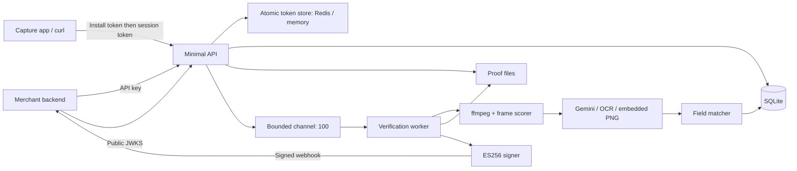
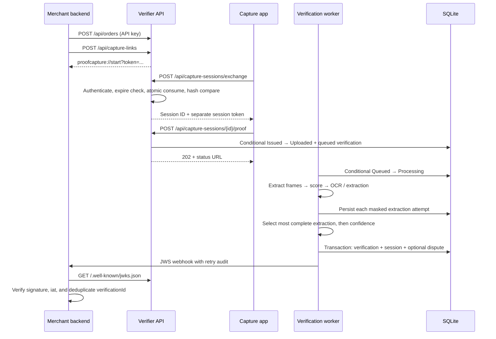
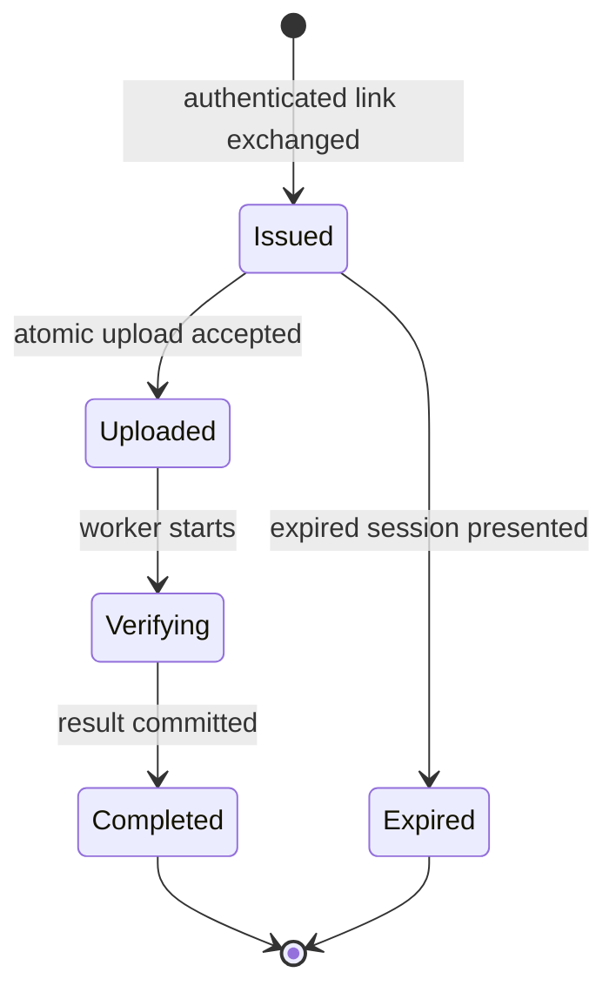
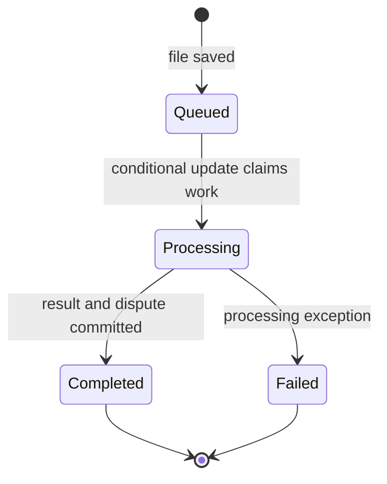
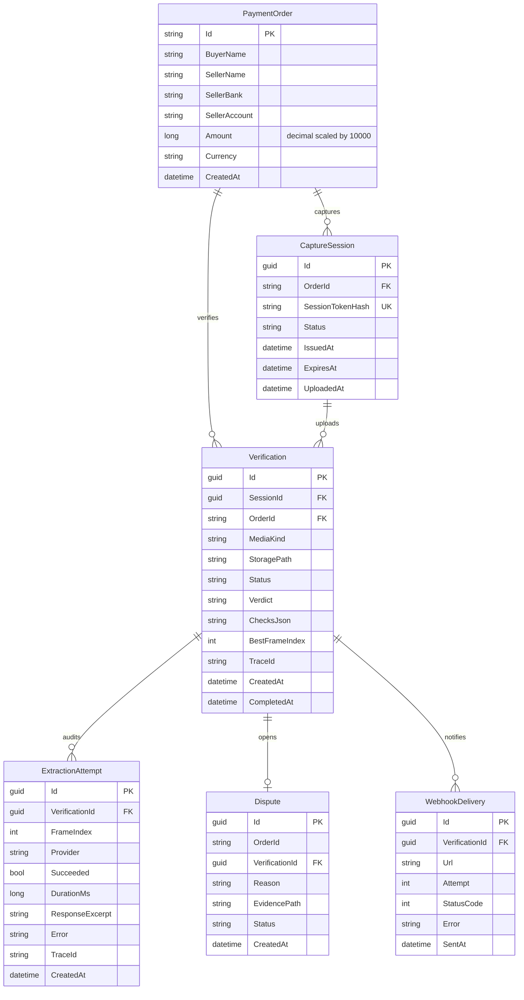

# Architecture

## Components

## Main sequence

## Capture session states

Expiry is checked on upload; no periodic expiry sweep runs. A failed worker leaves the session Verifying and the verification Failed for investigation.

## Verification states

The queue and retry schedule are process-local. Restart recovery, a durable outbox, and automatic resumption of Processing work are future work. A completed result stays completed even when webhook delivery fails.

## Data model

Proof files and receipts contain synthetic personal data. Only account suffixes appear in match checks and extraction excerpts. Raw OCR, provider response bodies, session tokens, and API keys are not logged. Embedded PNG extraction is only for deterministic demonstrations: it cannot establish receipt authenticity. A Matched result means the extracted fields agree with the order, not that funds settled.
